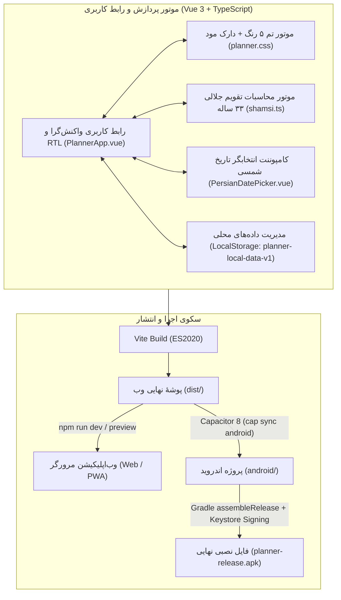

# پلنر شخصی (Persian Personal Planner)

> **سیستم عامل جامع و آفلاین مدیریت زندگی و برنامه‌ریزی فردی برای فارسی‌زبانان**  
> *راهنمای فنی، معماری و توسعه برای هوش مصنوعی (AI Agents) و توسعه‌دهندگان.*

یک وب‌اپلیکیشن مستقل و اپلیکیشن نیتیو موبایل (اندروید) با رویکرد **حفظ ۱۰۰٪ حریم خصوصی (Offline-First & Local Storage)**، مجهز به تقویم دقیق هجری شمسی، گیمیفیکیشن، ۱۵ نمای اصلی و ۲۴ ورک‌اسپیس تخصصی برای مدیریت تمام جنبه‌های زندگی، کار، درس و سلامت.

---

## ۱. معماری کلی سیستم (Architecture Overview)



---

## ۲. پشته فناوری (Technology Stack)

| بخش | فناوری‌های استفاده‌شده |
|---|---|
| **فریم‌ورک فرانت‌اند** | Vue 3 (Composition API، `<script setup>`) |
| **زبان و تایپ‌سیستم** | TypeScript 6 (بدون نیاز به کتابخانه‌های خارجی سنگین) |
| **تایپوگرافی و فونت** | وزیرمتن (`@fontsource/vazirmatn` با اوزان ۴۰۰، ۵۰۰، ۶۰۰، ۷۰۰ و ۸۰۰) |
| **آیکون‌ها** | متریال دیزاین آیکونز (`@mdi/font`) |
| **باندلر و ابزار بیلد** | Vite 8 + Rollup |
| **سکوی موبایل** | Capacitor 8 (`@capacitor/core`، `@capacitor/android`، `@capacitor/cli`) |
| **محیط بیلد اندروید** | Android Gradle Plugin 8.x، Java 17+، ساین V1 و V2 |
| **حریم خصوصی و ذخیره‌سازی** | ذخیره‌سازی محلی ۱۰۰٪ کلاینت (`localStorage`) همراه با بک‌آپ JSON |

---

## ۳. نقشه ساختار فایل‌ها و پوشه‌ها (File Map)

```
TubeMaster/ (Persian Planner Root)
├── README.md                          # مستندات کامل پروژه (این فایل)
├── package.json                       # اسکریپت‌ها، نسخه‌ها و وابستگی‌های پروژه
├── vite.config.ts                     # پیکربندی بهینه Vite 8 برای Vue 3
├── tsconfig.json                      # تنظیمات تایپ‌اسکریپت و کامپایلر
├── capacitor.config.ts                # پیکربندی کپسیتور برای پکیجینگ اندروید
├── index.html                         # نقطهٔ ورود اصلی وب‌اپلیکیشن پلنر
├── planner.html                       # ورودی دوم جهت سازگاری کامل
├── planner-release.apk                # فایل نصبی امضاشدهٔ ریلیز اندروید (مایکت / بازار / نصب مستقیم)
├── planner-debug.apk                  # فایل نصبی دیباگ اندروید
├── myket-icon-512.png                 # آیکون کیفیت بالا با رزولوشن ۵۱۲ برای مارکت‌ها
│
├── public/                            # دارایی‌های استاتیک و آیکون‌ها
│   ├── planner-icon.png               # آیکون مربعی استاندارد پلنر
│   └── planner-icon-round.png         # آیکون گرد پلنر
│
├── src/                               # کدهای منبع فرانت‌اند
│   ├── main.ts                        # نقطه ورود برنامه و مانت Vue روی #planner-app
│   ├── planner-main.ts                # ریدایرکت سازگاری به main.ts
│   ├── planner.css                    # استایل‌های تم‌ها، متغیرهای CSS، فونت‌ها و انیمیشن‌ها
│   ├── vite-env.d.ts                  # تعاریف تایپ‌های Vite
│   └── planner/
│       ├── PlannerApp.vue             # هستهٔ جامع ۱۵ نما، ۲۴ ماژول، گیمیفیکیشن و مدیریت کارها
│       ├── components/
│       │   └── PersianDatePicker.vue  # کامپوننت انتخاب تاریخ شمسی آفلاین با دراپ‌داون و میانبرها
│       └── utils/
│           └── shamsi.ts              # موتور محاسباتی تاریخ جلالی، تبدیل میلادی به شمسی و بالعکس
│
├── android/                           # پروژهٔ بومی اندروید استودیو
│   ├── app/
│   │   ├── build.gradle               # تنظیمات کامپایل، ساینینگ ریلیز و SDK
│   │   └── src/main/
│   │       ├── AndroidManifest.xml    # مانیفست اندروید (نام اپ: پلنر شخصی، پکیج: ir.tubemaster.planner)
│   │       └── res/                   # آیکون‌های تطبیقی، اسپلش اسکرین و استایل‌ها
│   ├── release-key.jks                # کلید رسمی امضای اپلیکیشن (Keystore)
│   └── gradlew.bat                    # گرادل رپر ویندوز
│
├── scripts/                           # اسکریپت‌های اتوماسیون
│   ├── prepare-mobile-web.mjs         # آماده‌سازی باندل وب برای محیط‌های ایزوله
│   ├── export-apk.mjs                 # کپی خودکار فایل APK دیباگ به ریشهٔ پروژه
│   ├── export-release-apk.mjs         # کپی خودکار فایل APK ریلیز امضاشده به ریشهٔ پروژه
│   ├── generate_planner_assets.py     # تولید خودکار آیکون‌های تطبیقی و اسپلش با پایتون Pillow
│   └── GeneratePlannerIcon.java       # هلپر جاوا برای تولید المان‌های بصری
│
└── market-assets/                     # دارایی‌های مارکتینگ برای انتشار در استورها
```

---

## ۴. قابلیت‌های کلیدی و نماهای پلنر

### ۴.۱. ۱۵ نمای اصلی برنامه (15 Core Views)

| شناسه نما | عنوان فارسی | توضیحات و امکانات |
|---|---|---|
| `dashboard` | **داشبورد** | خلاصه وضعیت امروز، حلقه عادت‌ها، کارهای فوری، لول، XP و دسترسی سریع. |
| `today` | **امروز** | مدیریت تمرکز، چک‌لیست کارهای روز، تایمر کار، یادآورها و یادداشت پایان روز. |
| `week` | **نمای هفته** | برنامه‌ریزی افقی ۷ روزه (شنبه تا جمعه)، جابجایی تسک‌ها و ژورنال هفتگی. |
| `month` | **تقویم ماه** | تقویم کامل شمسی ماهانه، روزهای تعطیل، مناسبت‌ها و مرور ماهانه. |
| `goals` | **اهداف و پروژه‌ها** | تعیین اهداف سالانه و فصلی، گام‌های اجرایی مرحله‌به‌مرحله و درصد پیشرفت. |
| `habits` | **عادت‌ها** | ردیاب عادت‌های روزانه و هفتگی همراه با شمارنده زنجیره (Streak) و ثبت استمرار. |
| `library` | **کتابخانه** | آرشیو کتاب‌ها، پادکست‌ها و فیلم‌ها با ثبت وضعیت، امتیاز و یادداشت‌های شخصی. |
| `roadmap` | **نقشه راه** | ترسیم افق‌های بلندمدت زندگی در بازه‌های فصلی و چندساله. |
| `schedule` | **زمان‌بندی روزانه** | برنامه‌ریزی ساعتی روزمره از صبح تا شب. |
| `history` | **تاریخچه فعالیت‌ها** | بایگانی کارهای انجام‌شده، جلسات ثبت‌شده و آرشیو اقدامات گذشته. |
| `finance` | **مدیریت مالی** | ثبت درآمد و هزینه، دسته‌بندی تراکنش‌ها، موجودی چند حساب، و لیست طلب‌ها و بدهی‌ها. |
| `notes` | **یادداشت‌ها و ژورنال** | دفترچه یادداشت دسته‌بندی‌شده و ژورنال‌نویسی روزانه، هفتگی و ماهانه. |
| `stats` | **آمار و پیشرفت** | تحلیل عملکرد، نمودارهای پیشرفت، XP کل کسب‌شده و سطح کاربر (گیمیفیکیشن). |
| `settings` | **تنظیمات** | تغییر تم (۵ رنگ)، حالت دارک، اهداف روزانه آب و کالری، پشتیبان‌گیری و بازیابی داده‌ها. |
| `workspace` | **ورک‌اسپیس‌ها** | میز کار اختصاصی برای ۲۴ ماژول تخصصی زندگی و کار. |

---

### ۴.۲. ۲۴ ورک‌اسپیس تخصصی در ۷ حوزهٔ موضوعی

```
├── سلامتی (Health & Wellness)
│   ├── calories         # کالری‌شماری (ثبت وعده‌های غذایی و مقایسه با هدف روزانه)
│   ├── water            # آب مصرفی (ثبت سریع لیوان‌های آب با میانبر یا مقدار میلی‌لیتر)
│   ├── exercise         # ورزش‌ها (نوع تمرین، مدت زمان، کالری مصرفی و یادداشت جلسه)
│   ├── mood             # مود ترکر (امتیاز حال روز از ۱ تا ۵ و احساس غالب همراه با محرک‌ها)
│   ├── sleep            # الگوی خواب (ساعت خواب، بیداری، مدت زمان و کیفیت خواب ۱ تا ۵)
│   ├── weight           # ثبت وزن (روند تغییرات وزن در تاریخ‌های مختلف)
│   └── sizes            # اندازه‌های بدن (اندازه‌گیری دور کمر، باسن، سینه، بازو و ران)
│
├── پروژه و کسب‌وکار (Projects & Business)
│   ├── projects         # پروژه‌ها و تسک‌ها (مشتری، همکار، مرحله، مهلت، بودجه و اقدام بعدی)
│   ├── contracts        # پروژه‌های قراردادی (کارفرما، مبلغ، تاریخ شروع و تحویل و مرحله)
│   └── delegated        # کارهای وابسته به دیگران (پیگیری تعهدات دیگران، مسئول و موعد)
│
├── مدیریت مالی (Finance & Wealth)
│   ├── savings          # پس‌انداز (مبلغ هدف، مبلغ فعلی و تاریخ موعد)
│   ├── installments     # اقساط (مبلغ هر قسط، تعداد باقی‌مانده و سررسید بعدی)
│   ├── checks           # چک‌ها (دریافتی/پرداختی، شماره چک، تاریخ صدور، سررسید و وضعیت وصول)
│   ├── car              # هزینه‌های خودرو (سوخت، سرویس، بیمه، تعمیرات و کیلومترشمار)
│   ├── appointments     # نوبت‌دهی مشتریان (نام مشتری، نوع خدمت، تاریخ، ساعت و مبلغ)
│   ├── courseSales      # فروش دوره‌ها (هنرجو، نام دوره، مبلغ کل و مانده)
│   └── wishlist         # خواسته‌ها و نیازها (تفکیک نیاز از خواسته با تخمین هزینه و اولویت)
│
├── لایف‌استایل (Lifestyle & Wellbeing)
│   ├── pets             # امور پت (غذا، دارو، واکسن، ویزیت دامپزشک و هزینه‌ها)
│   ├── prayer           # نماز و دعا (ثبت نمازها، ادعیه و اذکار روزانه)
│   ├── quran            # حفظ قرآن (ثبت سوره، صفحه جدید حفظ‌شده و مرورهای تثبیت)
│   ├── trips            # سفرها (مقصد، تاریخ، همسفران، بودجه و چک‌لیست لوازم)
│   ├── music            # موسیقی (آهنگ‌ها، آلبوم‌ها، هنرمندان و حال‌وهوای شنیداری)
│   ├── mind             # تخلیه ذهن (صندوقچه ثبت فوری ایده‌ها، نگرانی‌ها و کارهای پراکنده)
│   └── presence         # بودن در لحظه (تمرین حضور ذهن، تنفس، مدیتیشن و نمره آرامش ۱ تا ۵)
│
├── تدریس (Teaching)
│   ├── privateStudents  # شاگردهای خصوصی (اطلاعات شاگرد، درس، پایه، شهریه و جلسات)
│   └── classes          # کلاس‌ها (برنامه کلاس‌ها، روز و ساعت، موضوع و تکلیف)
│
├── درس و یادگیری (Study & Learning)
│   ├── leitner          # جعبه لایتنر کارتی (فلش‌کارت‌های دیجیتال با پرسش، پاسخ و فواصل مرور)
│   ├── spaced           # مرورهای فاصله‌دار (سیستم تکرار فاصله‌دار SRS بر مبنای یادآوری آسان/دشوار)
│   ├── courses          # دوره‌های آموزشی (دوره‌های در حال یادگیری، مدرس و درصد پیشرفت)
│   ├── student          # داشبورد دانشجو (درس‌ها، نمرات، واحدهای ترم و موعد تحویل پروژه‌ها)
│   ├── timeblocking     # تایم‌بلاکینگ (اتصال کارهای کلیدی به بازه‌های زمانی مشخص در تقویم)
│   └── applications     # اپلای (دانشگاه‌ها، رشته، مدارک، توصیه‌نامه و ددلاین‌های ارسال)
│
└── تخصصی (Specialist Roles)
    ├── shifts           # مدیریت شیفت‌ها (شیفت‌های کاری صبح، عصر، شب، آن‌کال و تعویض شیفت)
    ├── legal            # موکل‌ها و پرونده‌های حقوقی (شماره پرونده، موکل، مرجع رسیدگی و جلسات)
    ├── residency        # آزمون دستیاری (مباحث پزشکی، تعداد تست حل‌شده، درصد پاسخ و تسلط)
    ├── ux               # استودیوی UI/UX (مراحل تحقیق کاربر، معماری اطلاعات، وایرفریم، رابط و تحویل)
    └── writing          # پروژه‌های نویسندگی (سفارش محتوا یا کتاب با تعداد کلمه، هدف و ددلاین)
```

---

## ۵. موتور تقویم شمسی و انتخابگر تاریخ (`shamsi.ts`)

- **الگوریتم دقیق چرخه ۳۳ ساله کبیسه:** فرمول معتبر تقویم ملی ایران (`isLeapJalaliYear`) بدون خطا در سال‌های کبیسه.
- **توابع کلیدی:**
  - `gregorianToJalali(gy, gm, gd)` و `jalaliToGregorian(jy, jm, jd)`
  - `getShamsiMonthDays(jy, jm)` (ماه‌های ۱ تا ۶: ۳۱ روز، ۷ تا ۱۱: ۳۰ روز، اسفند: ۲۹ یا ۳۰ روز)
  - `getShamsiDayOfWeek(jy, jm, jd)` (شنبه: ۰ تا جمعه: ۶)
  - `toPersianDigits(value)` و `toEnglishDigits(value)`
  - `formatJalaliDisplay(date)` (نمایش رسمی به زبان فارسی، مثال: `۱۴ اسفند ۱۴۰۳`)
- **کامپوننت تقویم (`PersianDatePicker.vue`):** کامپوننت ماژولار و لمسی با دکمه‌های امروز، تغییر سال/ماه با دراپ‌داون، جابجایی ماهانه، و فرمت خروجی دلخواه (`iso` یا `shamsi`).

---

## ۶. تم‌ها و جلوه‌های بصری (`planner.css`)

برنامه دارای ۵ تم رنگی هارمونیک همراه با پشتیبانی از دارک مود است:
1. `theme-emerald` (**زمردی** - آرامش طبیعت و کارایی - پیش‌فرض)
2. `theme-ocean` (**اقیانوس آرام** - تفکر عمیق و رنگ آبی ملایم)
3. `theme-sunset` (**غروب مرجانی** - شور و انرژی بالا)
4. `theme-lavender` (**اسطوخودوس** - حس ذن و خلاقیت)
5. `theme-midnight` (**نیمه‌شب سرمه‌ای** - مدرن و چشم‌نواز در تاریکی)

کلید ذخیره‌سازی داده‌ها در مرورگر: `planner-local-data-v1` (همراه با قابلیت مهاجرت خودکار داده‌ها از نسخه‌های پیشین).

---

## ۷. اپلیکیشن اندروید (Capacitor & Android Build)

- **شناسه بسته (App ID):** `ir.tubemaster.planner`
- **نام نمایشی (App Name):** `پلنر شخصی`
- **پوشه محتوای وب:** `dist`
- **فایل کلید امضا (Keystore):** `android/release-key.jks`
  - نام مستعار کلید (Alias): `planner_key`
  - رمز عبور کلید و مخزن: `PlannerMyket2026!`
  - ساینینگ V1 و V2 فعال در [android/app/build.gradle](file:///c:/Users/VICTUS%2016/OneDrive/Documents/TubeMaster/android/app/build.gradle).

---

## ۸. دستورات خط فرمان (Command Reference)

```powershell
# ۱. نصب پیش‌نیازها
npm install

# ۲. اجرای سرور توسعه محلی (اجرای آنی پلنر روی http://localhost:5173)
npm run dev

# ۳. بررسی دقیق تایپ‌های تایپ‌اسکریپت بدون بیلد
npm run typecheck

# ۴. ساخت نسخه وب بهینه‌سازی‌شده در پوشه dist
npm run build

# ۵. پیش‌نمایش بیلد نهایی در لوکال
npm run preview

# ۶. همگام‌سازی دارایی‌های وب با محیط اندروید Capacitor
npm run sync:android

# ۷. بیلد APK دیباگ و ذخیره در ریشه پروژه (planner-debug.apk)
npm run build:android:debug

# ۸. بیلد APK رسمی امضاشده ریلیز و ذخیره در ریشه پروژه (planner-release.apk)
npm run build:android:release
```

---

## ۹. راهنمای هوش مصنوعی و توسعه‌دهندگان (AI Agent Guidelines)

1. **تمام پروژه اکنون متعلق به پلنر است:** پوشه‌ها و فایل‌های متفرقه کاملاً پاک شده‌اند و نیازی به ارجاع به اکستنشن یا کامپنیون نیست.
2. **عدم افزودن کتابخانه‌های سنگین بدون ضرورت:** پلنر برای سرعت بالا در وب و موبایل با CSS خالص، متغیرهای بهینه و بدون وابستگی‌های سنگین طراحی شده است.
3. **محاسبات تقویمی فقط با `shamsi.ts`:** برای هرگونه عملیات تاریخ، مقایسه روزها و ذخیره‌سازی همواره از توابع اختصاصی [shamsi.ts](file:///c:/Users/VICTUS%2016/OneDrive/Documents/TubeMaster/src/planner/utils/shamsi.ts) استفاده کنید و از توابع پیش‌فرض میلادی جاوااسکریپت برای مناسبات جلالی پرهیز نمایید.
4. **پوشه `webDir` در Capacitor مستقیماً برابر با `dist` است:** با اجرای `npm run build` و سپس `cap sync android`، فایل‌های کامپایل‌شده بلافاصله در اندروید جای‌گذاری می‌شوند.
